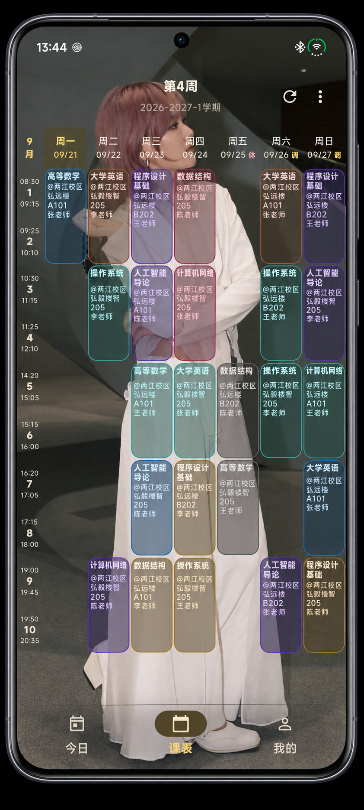
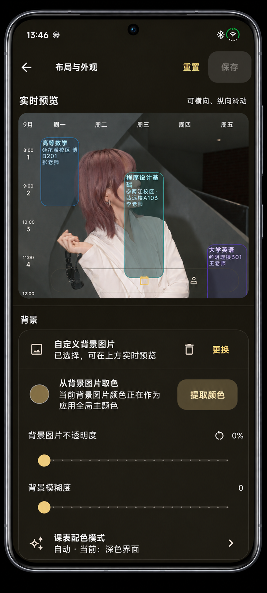
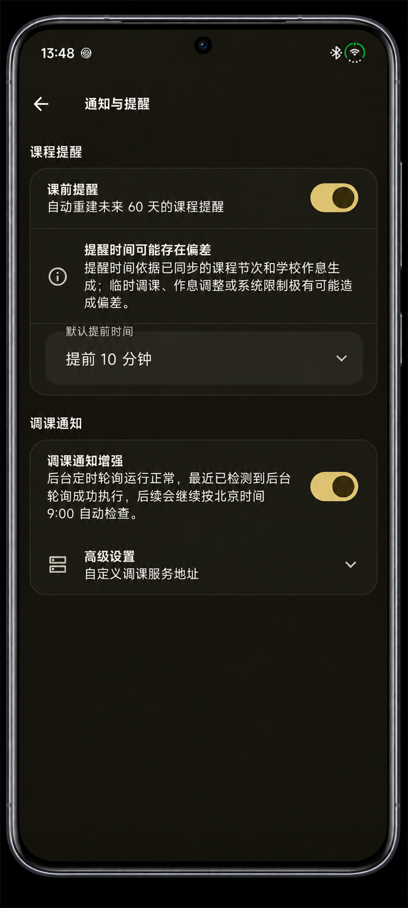

<div align="center">


# CQUT Helper

**西唯兵学子的课表小帮手**

面向重庆理工大学同学的第三方 Android / iPhone 课表助手。

[](https://github.com/lhgr/CQUT-Helper/releases)

[](LICENSE)

[下载最新版本](https://github.com/lhgr/CQUT-Helper/releases) ·
[核心功能](#-核心功能) ·
[应用截图](#-应用截图) ·
[问题反馈](https://github.com/lhgr/CQUT-Helper/issues)

</div>

> [!NOTE]
> CQUT Helper 是第三方非官方应用。重要课程与调课安排请以学校官方信息为准。

## ✨ 核心功能

| 功能 | 说明 |
| --- | --- |
| **今日与周课表** | 查看当天课程和完整周课表，支持周次切换、周末显示和离线缓存 |
| **假期与调休校历** | 根据学校通知的放假与调休日期将调休当天映射到对应课表安排 |
| **桌面小组件** | Android 提供今日课程、日视图、近日课程、超小课程和垂直列表等样式 |
| **课前提醒** | 根据本机课表安排课程通知，可设置默认提前时间 |
| **调课通知增强** | 可选查询当前学期调课信息，记录新增、变更和撤销，并刷新受影响教学周。iOS 在打开应用或手动同步时查询 |
| **课程个性化** | 支持课程别名、备注、颜色、隐藏状态，以及课程卡片和课表布局调整 |
| **主题与背景** | 支持亮色、深色、Material 3 动态取色、自选主题色和课表背景 |
| **备份与恢复** | 导出或恢复课表布局、主题、提醒和课程个性化设置，不包含登录凭据 |

课表同步后会缓存在本机，临时断网时仍可查看已有课程。放假与调休规则也会应用到
今日页、周课表、课程提醒和桌面小组件，减少特殊教学安排带来的日期混淆。

调课通知增强为可选功能，不开启也不影响登录、普通课表同步、课前提醒和桌面小组件。
详细行为和设置方法见 [调课通知增强功能说明](FastAPI/README.md)。

## 📱 应用截图

<table align="center">
  <tr>
    <td align="center"></td>
    <td align="center"></td>
    <td align="center"></td>
  </tr>
  <tr>
    <td align="center"><sub>周课表与假期调休</sub></td>
    <td align="center"><sub>布局、背景与课程卡片</sub></td>
    <td align="center"><sub>课前提醒与调课通知</sub></td>
  </tr>
</table>

## 平台支持

| 能力 | Android | iOS 15+ iPhone |
| --- | --- | --- |
| 登录、今日与周课表、缓存、校历、个性化、主题、备份 | 支持 | 支持 |
| 课表与调课同步 | 前台、手动及系统安排的后台任务 | 启动、返回前台、手动同步 |
| 课前提醒 | 通知及精确闹钟授权后安排 | 通知授权后安排近期本地提醒 |
| 桌面小组件 | 支持 | 本期未实现 |
| 课程期间自动勿扰或静音 | 支持的 Android 设备可开启 | 本期未实现 |

iOS 按最近课程时间优先安排本地通知，待发送通知总数最多 64 条。设置中的
“同步与修复”显示已安排数量、下一条提醒与实际覆盖截至时间。课程较多时覆盖时间
会短于计划窗口，需定期打开应用同步并续排。已经安排的通知由系统发送。

## 📦 下载安装

### Android

前往 [GitHub Releases](https://github.com/lhgr/CQUT-Helper/releases) 下载 APK：

| 安装包 | 适用设备 |
| --- | --- |
| **Arm64-v8a** | 绝大多数现代 64 位 Android 手机，建议优先选择 |
| **Armeabi-v7a** | 较旧的 32 位 Android 手机 |
| **x86_64** | 少数模拟器或 x86_64 Android 设备 |
| **Universal** | 不确定设备架构时使用，兼容范围更广但文件更大 |

> [!CAUTION]
> **旧版本升级**
>
> 从 v1.0.0 开始，应用启用了新的长期正式签名，无法从 v0.3.0 及更早版本直接覆盖安装。
> 请先确认账号密码可用，再卸载旧版本并安装新版。卸载会清除旧版本保存在本机的登录状态、课表缓存和设置。

### iPhone 个人侧载

1. 前往 GitHub Releases，在已公开的发行版中下载带版本号和阶段名的未签名 IPA，
   当前文件名为 `CQUT-Helper-1.2.1-alpha-unsigned.ipa`。Beta 阶段使用 `-beta`，
   稳定阶段文件名为 `CQUT-Helper-<版本号>-unsigned.ipa`。
2. 如需指定分支的构建，在 GitHub Actions 中手动运行 `Build unsigned iOS IPA`，
   选择分支后下载 `CQUT-Helper-unsigned-ios` artifact，解压得到对应 IPA。
3. 在 Windows 安装 Sideloadly，并按工具要求安装 Apple 设备驱动。连接 iPhone，
   在手机上信任这台电脑。
4. 在 Sideloadly 选择设备、该 IPA 和自己的 Apple ID，按工具提示完成个人签名及安装。
   可使用自己的开发者账号与证书。安装包本身为未签名产物，签名由侧载工具完成。
5. 在 iPhone 的“设置 → 通用 → VPN 与设备管理”中信任签名账号。
   iOS 16 及以上按系统提示开启开发者模式，之后启动应用。
6. 按所用账号和侧载工具的有效期要求续签。应用内“查看发行版”打开发行页，更新时
   下载对应 IPA 并重新签名安装。

侧载工具说明见 [Sideloadly 官网](https://sideloadly.io/)。

## 🚀 首次使用

1. 使用学校账号登录，进入课表并完成首次同步。
2. 按需调整周末显示、课程卡片、主题和课表背景。
3. 如需课前提醒，在“设置 → 通知与提醒”中开启相关权限。
4. Android 添加桌面小组件后，如果显示“课表尚未同步”，请回到应用同步一次课表。
5. 按需在通知设置或课表设置中开启“调课通知增强”。iOS 会在启动、返回前台和手动同步时检查。
6. iPhone 开启课前提醒后，在“同步与修复”确认实际提醒覆盖，定期打开应用更新。

## 🔒 隐私与网络请求

CQUT Helper 不接入 Firebase，也不包含遥测或用户行为统计服务。应用会按功能需要
发起以下网络请求：

| 场景 | 请求内容与用途 |
| --- | --- |
| **学校登录与课表** | 登录时向学校统一认证系统提交登录所需信息，并向学校课表服务请求账号和课表数据 |
| **公开内容** | 请求应用公告、今日一言、假期与调休校历配置，以及 GitHub 版本信息；这些请求不需要发送学校账号凭据或个人课表 |
| **调课通知增强** | 仅在主动开启并确认隐私提示后，向所选调课服务发送学号、教务系统加密密码和当前学期，用于代为查询调课通知 |

- 登录凭据通过系统安全存储保存在设备上；课表缓存、个性化设置和消息记录保存在本机。
- 关闭调课通知增强后，应用不会继续访问官方或自定义调课服务；退出登录也会关闭该功能并清除授权状态。
- 配置自定义调课服务后，请求不会在失败时静默回退到官方服务。
- 加密密码不是明文密码，但仍可用于访问教务系统，请只选择自己信任的调课服务。
- 备份文件不包含登录密码、可用于登录的凭据、诊断日志、课表缓存或自定义背景图片。

## ❓ 常见问题

### Android 小组件没有及时刷新

先打开应用确认登录状态并手动同步课表，再点击小组件刷新。如果仍无改善，请在
“设置 → 同步与修复”中检查后台状态，并根据手机系统设置允许应用自启动、后台运行
和忽略电池优化。

### Android 小组件显示“课表可能已过期”

这表示本机缓存较长时间没有得到成功同步确认。检查网络和登录状态后主动刷新即可。
如果最近已经成功同步，但当前不属于教学周，小组件会显示“当前不在教学周”。

### 放假或调休日期与学校安排不一致

先进入课表设置刷新假期与调休信息，再主动同步相关教学周。校历配置用于辅助展示，
如仍有差异，请以学校最新通知和教务系统课表为准，并通过 Issue 反馈。

### 收不到课前提醒或调课通知

Android 检查通知权限、后台运行限制和电池优化设置。iPhone 检查系统通知授权，
并在“同步与修复”查看已安排数量和覆盖截至时间，打开应用同步续排。调课通知需要
主动开启“调课通知增强”，并确保所选服务通过“检查服务可用性”。

### 备份会保存密码吗？

不会。备份只包含设置与课程个性化数据，不包含登录密码、可登录凭据、日志或课表缓存。

## 🧩 项目说明

这是一个个人学习项目，在 AI 协助下持续完善。欢迎通过
[GitHub Issues](https://github.com/lhgr/CQUT-Helper/issues) 提交问题或建议，也可以发送
邮件至 <dawndrizzle0104@gmail.com>。

### 本地开发与构建

开发环境使用 Flutter 3.47.7（Dart 3.13.5）。首次获取依赖并构建 Release APK：

```bash
flutter pub get
flutter build apk --release
```

iOS 构建需要 macOS 15.6+ 和 Xcode 26+，CI 明确使用 Xcode 26.3。
现有插件使用 iOS 26 SDK 中的类型。项目以 iOS 15 为最低版本，仅面向 iPhone。

```bash
flutter pub get
eval "$(python3 tool/release_metadata.py)"
eval "$(dart tool/ios_release_metadata.dart "$build_name")"
flutter build ios --release --no-codesign \
  --build-name="$build_name" --build-number="$build_number"
mkdir -p build/ios-sideload/Payload
cp -R build/ios/iphoneos/Runner.app build/ios-sideload/Payload/
cd build/ios-sideload
zip -qry "$ipa_filename" Payload
shasum -a 256 "$ipa_filename" > SHA256SUMS.txt
```

CI 与发布 workflow 均固定使用 Flutter 3.47.7。`Quality Gate` 在 push、Pull Request
和默认手动运行时执行分析、测试与 Release 构建。iOS 在独立 macOS 作业中执行
`flutter build ios --release --no-codesign`，构建日志上传为 `ios-release-build-log`。

需要查看 iOS 界面时，手动运行 `Quality Gate` 并勾选 `capture_ios_screenshots`。
该参数默认关闭，开启后额外构建 Debug 模拟器应用、启动 iPhone 模拟器并安装运行，
将截图与模拟器日志上传为 `ios-simulator-smoke`。本地模拟器构建命令为
`flutter build ios --simulator --debug`。

推送 `vX.Y.Z` 标签后，`Build and Release` 先校验标签、数字版本和递增 build，
再以同一源码提交和版本并行构建 Android 与未签名 iOS IPA。两端成功后汇总
`CQUT-Helper-SHA256SUMS.txt`，创建或更新同一 GitHub Release 草稿，发行类型保持正式版。
维护者公开草稿后即可在发行页下载 IPA，并完成个人签名安装。

手动运行 `Build and Release` 时，所选源码必须与 `tag_name` 指向同一提交。
勾选 `skip_release` 可在分支上验证打包，`tag_name` 仍填写与项目版本对应的
`vX.Y.Z`，允许该标签尚未创建。两端产物、构建日志及带总校验和的
`CQUT-Helper-release` artifact 仍会上传。也可独立手动运行
`Build unsigned iOS IPA`，选择分支获取 `CQUT-Helper-unsigned-ios` artifact。

iOS 阶段在 `lib/utils/ios_release.dart` 统一配置，关于页提示与 IPA 文件名由此生成。
Alpha、Beta 后缀用于展示和文件名，原生构建版本始终采用 `pubspec.yaml` 的数字版本与 build。

macOS CI 已通过 iOS 模拟器编译、安装与启动验收，截图确认登录页正常显示，
设备 Release 未签名 IPA 构建通过，下载产物的 SHA-256 校验匹配。
[查看 CI 验收记录](https://github.com/lhgr/CQUT-Helper/actions/runs/42015154561)。

核心业务已有自动测试覆盖。iPhone 真机登录与同步、通知授权与锁屏提醒、个人签名安装
及续签、文件系统交互仍待真机验证。

有关课表数据接口的分析可参阅
[课表 API 相关文章](https://blog.dawndrizzle.top/blog/reverse-timetable)。

## 📚 参考与协议

- [cqut-net-login](https://github.com/CQUT-handsomeboy/cqut-net-login)：密码加密模块参考。
- [Wake Up 课程表](https://www.wakeup.fun/) 与
  [拾光课程表](https://github.com/XingHeYuZhuan/shiguangschedule)：桌面小组件样式参考。
- [CQUT-Course-Guide-Sharing-Scheme](https://github.com/Royfor12/CQUT-Course-Guide-Sharing-Scheme)：
  感谢参与资料整理和分享的同学。

本项目采用 [Apache License 2.0](LICENSE) 开源。

## 👀 访问统计

<p align="center">
  
</p>
